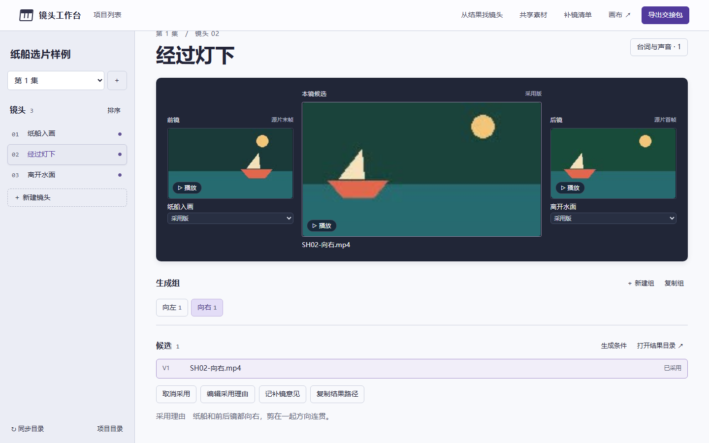

# AI Canvas · 本地 AI 短片选片与交接台

同一镜从即梦、可灵下载了几条视频，哪条接得上前后镜？在本机逐条看，点「采用此版」，愿意的话留一句为什么。交给剪辑时，按镜号排好的视频和一张离线清单一起走。粗剪后才发现问题，也可以回到那条候选上写明要改什么。

**先看剪辑拿到什么。** 解压选片包，用浏览器打开 `index.html`。第二镜采用了向右的纸船，向左那版仍有一条待改意见。两版的文件名和各自的说明都能在同一镜下找到。[纸船选片交接包](examples/paper-boat-selected.zip) · [观看选片演示](examples/paper-boat-demo.mp4)



## 在 Windows 启动

安装 Python 3.10（含 Tcl/Tk）、Node.js 22.12 或更新的 22.x，以及 FFmpeg（将 `ffmpeg` 和 `ffprobe` 加入 PATH）。解压项目后双击 **`start.cmd`**。首次启动会联网安装依赖并构建界面，随后在本机浏览器打开。想先试三个样例镜头，可在项目根目录运行 `.\start.cmd --demo`。[样例说明](examples/README.md)

## 用自己的短片

1. **把候选存到镜头目录。** 点「创建镜头项目」，选择项目位置，添加镜头和生成组。每组把参考图放进 `参考素材`，把下载的视频存进 `生成结果`。提示词和生成配置各有一个可留空的文本文件。同一组只记一次，换条件时可「复制生成组」。工作台自动同步，原文件也能直接拖到剪映。
2. **选一条用。** 切换候选，对照前镜末帧和后镜首帧。鼠标移到哪一格，哪一格就放大，点击可播放。点「采用此版」即可。想记下取舍时，展开「写采用理由」再采用，之后仍能编辑。还没定的镜头可以留作「待选」。
3. **交给剪辑。** 点「导出交接包」→「下载选片交接包」。接手人解压后，从 `定稿` 目录按镜序取片，在 `index.html` 查每镜采用的版本、理由和仍待处理的意见。

**需要补镜时**，从剪辑软件找到源文件，拖到「从结果找镜头」。在对应候选点「记补镜意见」，写下要改什么、要保留什么。新结果仍按上面的办法选。换了采用版，原意见继续挂在被指出的版本上，核对后点「确认解决」。需要请别人重做这一镜时，可以另发带原片、参考、提示词、声音和前后镜的[单条补镜包](examples/paper-boat-issue.zip)。

**跨集复用**　角色、场景、道具及声音存于项目的 `共享素材`。例如 `共享素材/角色/女主/V1/定妆.png`。换造型时添加 V2，可以查回哪些镜头和生成组仍用 V1。台词、临配、正式配音和声音参考均按需关联，正反打可共用同一段音频。

**晚补资料**　运行时工作台定期扫目录，重启后补扫。多个生成条件版本都有可能对应同一候选时，界面显示待补记，由人选择。软件只读取登记目录，从生成网页复制哪些信息由创作者决定。

## 文件与备份

| 位置 | 保存内容 |
| --- | --- |
| 自选项目目录，例如 `我的短片/EP01/SH05/G01/` | 日常使用的参考素材、文字、配置与下载结果。镜头改顺序后，剪辑软件仍可使用原路径。 |
| `%LOCALAPPDATA%/AI_Canvas/ShotHandoff/` | 项目数据库、已固定版本的媒体和预览缓存。覆盖工作目录中的文件后仍可找回已记录的旧版。 |
| 导出的选片 ZIP | 按镜序命名的采用版、相关生成资料、声音及离线清单。待选镜头也列在清单中，未解决意见标明对应的原版本。 |

完整备份时关闭应用，一起复制项目目录和应用数据目录。移动项目后可在「项目目录」中重新定位。旧版画布可以从项目内的「画布」入口进入。基础线 0012 数据可用备份副本迁移，启动前将 `AI_CANVAS_DATA_DIR` 指向该副本。

支持本地 PNG、JPEG、WebP 静态图片，常见 H.264 MP4/MOV、VP8/VP9 WebM、兼容编码的 MKV，以及 MP3 和 PCM WAV。归档时检测实际编码；浏览器的预览能力取决于系统编解码器。项目按内容保存已登记的媒体版本，需要给应用数据目录留出磁盘空间。

## 开发与验证

技术栈为 React、TypeScript、FastAPI、SQLite 和 FFmpeg。开发环境与发布环境均使用本机回环服务。常用命令在项目根目录运行。

```powershell
.\start.cmd --prepare-only
.\scripts\check.ps1
npm.cmd run e2e:release --prefix apps/web
```

原画布的开发与迁移记录见[基础画布文档](docs/foundation-development.md)。用自己的片子比较文件夹和工作台，可使用[选片与隔日交接对照记录](examples/隔日对照记录.md)。

源码采用 [MIT 许可证](LICENSE)。
